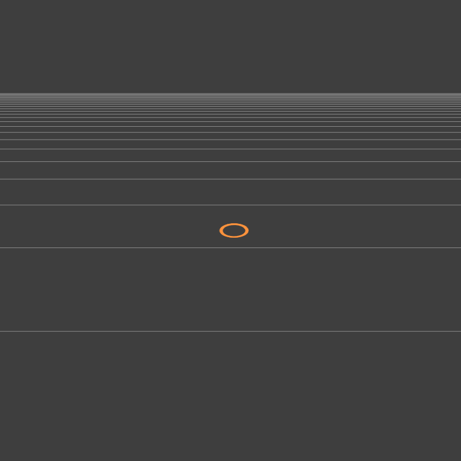
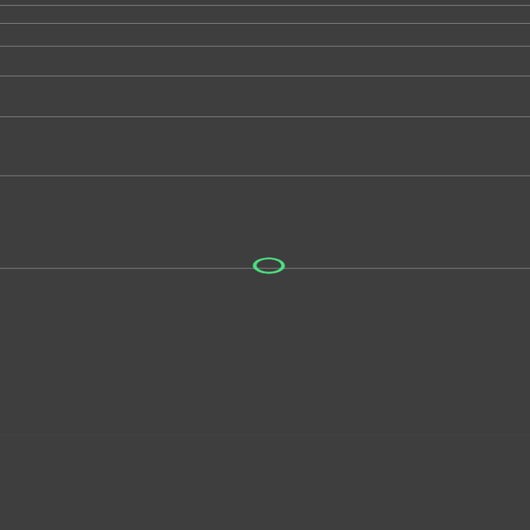
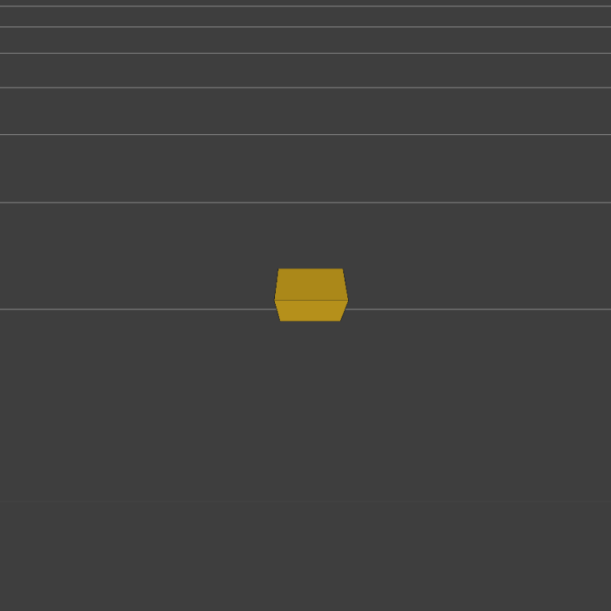

# Sesión 39 · Actividades y entregables

Realidad aumentada con WebXR (2/2): hit-test, retícula, anclas y gestos.
Autor: Anthony Alejandro Gonzalez Sanchez · Electiva III – PWA · UPTC

Base de trabajo: checkpoint `pwa-ar-objetos3d-sesion39.zip`. Todo se probó con el emulador IWER y una sala
sintética (Playwright + Chromium); no se usó un teléfono. Los scripts están en `Proyectos/pruebas-actividades/`.

---

## Actividad 1 · El plan B, desactivado pieza por pieza (en parejas)

Se abrió la sesión cuatro veces con el arnés, quitando funciones de la petición antes de que llegue al
navegador (si la app exige una función que se quitó, el arnés responde `NotSupportedError`, como un teléfono
real). En cada corrida se miró al suelo, se tocó para colocar el cubo y se leyeron la ayuda y la línea de datos.
Salida completa: `salidas/39-1-combinaciones.txt` (script `a39_1.js`).

| Combinación | Mensaje de ayuda tras tocar | ¿Anclado? | Posición del cubo |
|---|---|---|---|
| Con todo | Cubo colocado. Toca otro punto para recolocarlo. | sí | (0,00; −1,40; −2,34) m |
| Sin anchors | Cubo colocado. Toca otro punto para recolocarlo. | no | (0,00; −1,40; −2,34) m |
| Sin hit-test | Este dispositivo no ofrece hit-test: el cubo está a 1,5 m delante. Toca para traerlo delante de ti. | no | (0,00; −0,26; −1,45) m |
| Sin hit-test ni anchors | Este dispositivo no ofrece hit-test: el cubo está a 1,5 m delante. Toca para traerlo delante de ti. | no | (0,00; −0,26; −1,45) m |

Notas de la corrida:

- Sin hit-test, la primera petición (hit-test requerida) recibió `NotSupportedError` y la app reintentó con todo
  opcional. Ese es el reintento que la guía describe.
- `dom-overlay` no aparece concedido en ninguna corrida porque IWER no lo implementa.
- La línea de estado general sí distingue los casos: «El navegador no concedió: dom-overlay, anchors» o
  «… dom-overlay, hit-test».

**¿En cuál de las cuatro combinaciones un usuario no se daría cuenta de que falta algo?** En «sin anchors». La
ayuda es idéntica a la de «con todo», el cubo aparece en el mismo punto y solo la línea de datos dice
`anclado: no`, que un usuario normal no lee. En las dos combinaciones sin hit-test el cambio sí se nota: no hay
anillo y el texto lo dice.

**¿Es bueno o malo que no se dé cuenta?** En el momento es bueno: sin anclas la app sigue siendo útil y no tiene
sentido alarmar a alguien por una función que no puede activar. El riesgo aparece con el tiempo: sin ancla, el
sistema no corrige la posición y el cubo puede «deslizarse» unos centímetros si el seguimiento se reajusta. Si
eso pasa, el usuario no sabrá por qué. Una solución intermedia sería no avisar al colocar, pero sí mostrar una
línea discreta («posición no anclada») en el diagnóstico o cuando la deriva sea visible.

---

## Actividad 2 · Una retícula con significado (individual)

**Cambio** (`codigo/39-2-reticula.diff`):

- `visor.ts`: en cada consulta del hit-test se lee el elemento 5 de `pose.transform.matrix` (la componente
  vertical del eje Y, que es la normal de la superficie). Si `|y| > 0,8` la superficie es «horizontal».
- Se cambia el color del material que ya tiene la retícula (`materialReticula.color.setHex`), sin crear otro:
  verde `#4ade80` en horizontales y naranja `#fb923c` en las demás.
- La fase solo pasa a «listo» sobre una horizontal, y `colocar()` sale sin hacer nada si el impacto es de una
  superficie inclinada.
- `EstadoAR` gana el campo `superficie` («ninguna», «horizontal» o «inclinada»). `main.ts` lo muestra en la línea
  de datos y cambia la ayuda: «Esa superficie no es horizontal (anillo naranja): apunta al suelo o a una mesa…».

**Prueba nueva** (`a39_2.js`): a la sala sintética se le añade una segunda entidad, una pared de 6 × 3 m a 1,5 m
delante, mirando hacia el usuario (orientación −90° sobre X, para que su frente, el −Y local, quede hacia +Z).

| Caso | Qué se comprueba | Resultado |
|---|---|---|
| K1 | Mirando 34° hacia abajo el rayo choca con la pared: superficie «inclinada»; tocar no coloca ni crea ancla | ✓ |
| K2 | Mirando 57° hacia abajo el rayo llega al suelo: «horizontal», fase «listo»; tocar coloca y ancla, con el centro a 20 cm del suelo | ✓ |
| K3 | Con el cubo puesto, apuntar a la pared y tocar no lo recoloca | ✓ |

Salidas: `salidas/39-2-prueba-pared-a39.txt` (con el cambio: «RESULTADO: todo en orden») y
`salidas/39-2-prueba-pared-s39-original.txt` (la misma prueba contra el checkpoint sin cambiar: 5 fallos). La
prueba falla sin el cambio, así que sí comprueba algo.

**Capturas** (emulador IWER; las líneas son la rejilla del entorno y la imagen sale algo achatada por la
proporción del emulador):

| Retícula sobre la pared | Retícula sobre el suelo | Cubo colocado |
|---|---|---|
|  |  |  |

---

## Actividad 3 · Quitar el cubo (individual)

**Código** (`codigo/39-3-quitar-cubo.diff`, aplicado sobre el de la actividad 2):

- `index.html`: botón «Quitar cubo» en el overlay, junto a «Salir de AR».
- `visor.ts`: nuevo método `quitarObjeto()`. Borra el ancla, oculta el cubo, incrementa `turno` y vuelve a la fase
  «buscando», o a «listo» si la retícula ya está sobre una superficie horizontal. Sin hit-test vuelve a «listo»,
  y el siguiente toque usa el plan B.
- `main.ts`: el botón solo se ve con un cubo colocado y cancela `beforexrselect`. La ayuda sin hit-test ahora
  distingue entre «colocado» y «toca para colocar».

**Predicción, escrita antes de probar.** Sin el `beforexrselect`, el toque en el botón llegaría también a la sesión
como `select`. El mismo toque que quita el cubo lo volvería a colocar en la retícula, con un ancla nueva. El botón
parecería no hacer nada, o el cubo parpadearía en el mismo sitio.

**Lo observado** (`salidas/39-3-quitar-cubo.txt`, script `a39_3.js`). Como IWER no tiene dom-overlay, el arnés
emula el toque de un teléfono: lanza `beforexrselect` sobre el botón y, si nadie lo cancela, un `select`. La
especificación no fija el orden entre el `click` del botón y el `select` de la sesión, así que se probaron los dos:

| Caso | Resultado |
|---|---|
| Q1, con `beforexrselect` | El cubo desaparece, fase «listo», 1 ancla creada y 1 borrada, el botón se oculta. Un toque nuevo lo vuelve a colocar. Mirando al techo, la fase es «buscando». |
| Q2a, sin `beforexrselect`, primero el click | Se cumple la predicción: el cubo sigue colocado en el mismo sitio, con un ancla nueva (2 creadas y 1 borrada). |
| Q2b, sin `beforexrselect`, primero el select | El cubo termina quitado, pero se creó y se borró un ancla de más (2 y 2). |
| Q3, carrera (el ancla tarda 600 ms en crearse y se pulsa «Quitar» antes) | El ancla tardía se borra sola y el cubo no reaparece (1 y 1). |
| Q4, sin hit-test | Quitar deja la fase en «listo» y un toque lo coloca delante. |

La predicción se cumple en uno de los dos órdenes posibles. En el otro, el defecto queda escondido: funciona,
pero cada toque crea y destruye un ancla.

**¿Hace falta alguna precaución con una creación de ancla todavía pendiente?** Sí. `createAnchor()` devuelve una
promesa. Si el usuario pulsa «Quitar» antes de que se resuelva, el ancla llega después y, sin protección, volvería
a fijar un cubo que ya no debería existir. La solución reutiliza el número de `turno` de la guía: `quitarObjeto()`
lo incrementa, y cuando la promesa se resuelve con un turno viejo, `colocar()` borra el ancla en vez de guardarla.
El caso Q3 lo comprueba.

---

## Lo que no se pudo comprobar

Todo lo anterior es lógica probada en un emulador. Faltan comprobar en un teléfono con ARCore: que la normal de
las superficies reales sea estable (en una mesa con textura la retícula podría alternar entre verde y naranja),
que los toques reales sobre el overlay se comporten como la emulación y el orden real entre `click` y `select`.
