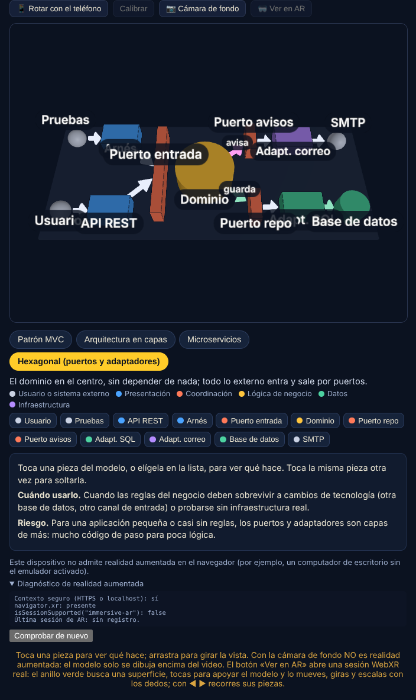

# Sesión 40 · Actividades y entregables

Modelos de arquitectura en 3D (MVC, capas y microservicios como datos).
Autor: Anthony Alejandro Gonzalez Sanchez · Electiva III – PWA · UPTC

Base de trabajo: checkpoint `pwa-ar-objetos3d-sesion40.zip`. Scripts en `Proyectos/pruebas-actividades/`.

---

## Actividad 1 · Un cuarto modelo, solo con datos (en parejas)

Se agregó la **arquitectura hexagonal (puertos y adaptadores)** sin tocar `constructor.ts`:

| Archivo | Qué contiene |
|---|---|
| `src/modelos/hexagonal.ts` | 12 piezas y 11 enlaces. El dominio va en el centro; a la izquierda, el lado que lo usa (usuario, pruebas, API REST, arnés, puerto de entrada); a la derecha, lo que el dominio necesita (puertos de repositorio y de avisos, adaptadores SQL y de correo, base de datos, servidor SMTP) |
| `src/modelos/index.ts` | una línea: `HEXAGONAL` entra al `CATALOGO` |
| `public/modelos/hexagonal.json` | la ficha: resumen, cuándo usarlo, riesgo y la responsabilidad de cada pieza |

Los tres archivos están en `codigo/archivos-modelo-hexagonal/` y el diff en `codigo/40-1-modelo-hexagonal.diff`.

Comprobación (`salidas/40-1-cuarto-modelo.txt`, script `a40_1.js`): aparecen cuatro pestañas
(`mvc, capas, microservicios, hexagonal`), el modelo tiene 12 piezas, la leyenda muestra los seis roles y la ficha
se carga por red. Al elegir «Dominio» aparece su responsabilidad y con quién habla.



Con la pieza «Dominio» elegida: `capturas/40-1-hexagonal-nucleo.png`.

Para que se leyera hubo que ajustar solo datos: elevación de cámara de 38° a 62°, filas más separadas, nombres más
cortos («Adapt. SQL») y la posición de algunos rótulos. Aun así, «Arnés» y «Adapt. SQL» quedan medio tapados por
otros rótulos desde este ángulo. Es el mismo problema de la actividad 2.

**¿Qué parte del modelo no pudieron expresar con `Pieza` y `Enlace`?**

1. **La dirección de la dependencia.** En hexagonal, el adaptador SQL *implementa* el puerto que define el dominio.
   La llamada va del dominio al adaptador, pero la dependencia va al revés. `TipoEnlace` solo tiene «llamada»,
   «evento» y «datos», así que se dibujó la llamada y la inversión de dependencias, que es la idea central del
   patrón, solo se explica en la ficha.
2. **El «hexágono» como frontera.** Dominio y puertos forman una frontera, y los puertos son parte de su borde.
   No hay forma de decir «estas piezas forman un grupo» ni de dibujar un contorno: los puertos quedaron como cajas
   delgadas sueltas al lado del cilindro.
3. **Lado conductor y lado conducido.** Solo se distinguen por la posición (izquierda y derecha); no hay un dato
   que lo diga.

**¿Cambiarían los tipos o el dibujo?** Primero los tipos, porque son el contrato: un `TipoEnlace` nuevo,
«implementa», y un campo opcional `grupos` en `DefinicionModelo` con la lista de piezas de cada frontera. Luego el
dibujo, porque un tipo nuevo necesita su estilo (flecha punteada en `COLOR_ENLACE` y en `crearFlecha`) y el grupo
necesita un contorno. Cambiar solo el dibujo sin el tipo obligaría a adivinar desde el constructor qué enlaces son
de implementación.

---

## Actividad 2 · Auditar los rótulos (individual)

### Medidas y cuenta

No se tuvo un teléfono para medir con regla, así que la altura se calculó desde el código y se comprobó con el
emulador.

- En `constructor.ts`, un rótulo de pieza mide `0,4·k` de alto, con `k = lado / 6`. El modelo se normaliza para que
  su lado mayor valga 1,6. Por eso el rótulo mide `0,4 × 1,6 / 6 ≈ 0,107 m` a escala 1 **en cualquier modelo**.
- Ese alto es el del lienzo, que es 1,7 veces la fuente. La letra mide `0,107 / 1,7 ≈ 0,063 m` a escala 1.
- **A escala 0,25 (40 cm)**, el rótulo entero mide **2,7 cm** y la letra, **1,6 cm** de texto real. Los rótulos de
  enlace (0,3·k) miden 2,0 y 1,2 cm.

En pantalla, para un teléfono con campo de visión vertical de unos 64° y 860 px CSS de alto, la letra ocupa
aproximadamente `px = (alto de la letra / distancia) × 688`:

| Escala | Letra real | En pantalla a 1,5 m (estimado) |
|---|---|---|
| 0,25 | 1,6 cm | 7 px |
| 0,40 | 2,5 cm | 11 px |
| 0,57 | 3,6 cm | 16 px |
| 1,00 | 6,3 cm | 29 px |

La guía cuenta que en el teléfono «a escala 0,57 los rótulos se leen». Eso cuadra con la tabla: 16 px se leen y 7
px no.

**Propuesta:** avisar «agranda el modelo para leer los nombres» cuando la letra quede por debajo de **12 px CSS**
en pantalla. Con un umbral fijo de escala habría que suponer la distancia (a 1,5 m sería escala 0,42; a 1 m,
0,28). Medirla en pantalla tiene en cuenta escala y distancia juntas, y eso fue lo que se implementó.

### Fragmento que muestra el aviso (`codigo/40-2-aviso-rotulos.diff`)

```ts
// visor.ts — cada 15 fotogramas con el modelo colocado
const ALTO_LETRA = (0.4 * 1.6) / 6 / 1.7; // ≈ 0,063 m a escala 1
const MIN_LETRA_PX = 12;
function medirLetra(): number {
  const xrCam = renderer.xr.getCamera();
  const cam = xrCam.cameras[0] ?? xrCam;
  grupo.getWorldPosition(p1);
  // Los rótulos son sprites (miran a la cámara): el segmento se mide en la dirección «arriba» de la cámara.
  p2.set(0, 1, 0).applyQuaternion(cam.getWorldQuaternion(q)).multiplyScalar(ALTO_LETRA * escala).add(p1);
  p1.project(cam);
  p2.project(cam);
  return Math.round((Math.abs(p2.y - p1.y) / 2) * window.innerHeight);
}
// main.ts — en ayudaAR(), fase «colocado»
if (e.rotulosPequenos) return "Agranda el modelo para leer los nombres: pellizca hacia fuera o acércate.";
```

Prueba con IWER (`salidas/40-2-aviso-rotulos.txt`, script `a40_2.js`): a escala 0,25 la letra mide 2 px a 2,3 m
y 4 px a 1 m, y el aviso aparece. Tras un pellizco que lleva la escala a 0,88, mide 18 px y el aviso desaparece.
El emulador tiene un campo de visión mucho más amplio que un teléfono (unos 110°), por eso sus píxeles son menos
que los de la tabla. La lógica es la misma.

Un error que salió al probar: la primera versión medía el segmento en la vertical del mundo y, mirando el modelo
desde arriba, salía acortado (2 px en vez de 4). Como los rótulos siempre miran a la cámara, hay que medir en la
dirección «arriba» de la cámara.

### Dos remedios para «publica» encima de «Bus de mensajes»

1. **Quitar los rótulos de enlace de la vista general y mostrarlos solo al elegir una pieza.** Sin pieza elegida no
   hay rótulos de enlace que choquen, desde ningún ángulo. Al elegir «Pedidos» aparece «publica», que es justo
   cuando interesa.
2. **Ordenar los rótulos en pantalla en cada fotograma.** Proyectar cada rótulo, detectar los que se superponen y
   ocultar o desplazar el de menor prioridad (primero los de enlace y luego los de pieza). Resuelve también los
   choques entre nombres de piezas.

**Elegiría el 1.** Cuesta casi nada (una línea en `resaltar`), no consume tiempo por fotograma en el teléfono y
quita de raíz el tipo de choque que se vio. Su costo es que el significado de las flechas no se ve de un vistazo
(en Capas se pierde «solicita» y «responde» hasta elegir una capa). El 2 es más completo, pero en AR cada
milisegundo por fotograma cuenta y es más difícil de probar. Este remedio se implementó en la actividad 3 de la
Sesión 41.

---

## Actividad 3 · Una prueba que falle antes de pasar (individual)

Se reconstruyó el escenario I (base v2 con datos de la demo, abrir la app y leer la base) y se le añadieron dos
casos: I3, un usuario que viene de la **v1**, e I4, lo que ve sin conexión el usuario de la v2 que ya había
descargado las fichas (script `a40_3.js`). Se corrió sobre tres compilaciones:

| Compilación | I2: base v2 tras abrir | I3b: base v1 tras abrir | I4: sin conexión |
|---|---|---|---|
| Original (`salidas/40-3-escenario-I-s40.txt`) | `mvc` (favorito, 111) y `microservicios`; descargas `capas` y `mvc` **pendiente** | `mvc` y `microservicios` | la lista no marca nada como «disponible sin conexión» y la ficha avisa que hay que descargarla |
| Sin `reiniciarDescarga` (`v40a`, `codigo/40-3-roto-sin-reiniciar.diff`) | igual, pero descargas `capas` y `mvc` **listo** | igual | la lista dice **«✓ disponible sin conexión»** en MVC y Capas, pero sin red la ficha de MVC no se puede leer |
| `oldVersion > 1` en vez de `>= 1` (`v40b`, `codigo/40-3-roto-mayor-que.diff`) | **igual que el original** | `modelo-demo-1` y `modelo-demo-3` **sin renombrar** | igual que el original |

**Qué línea cambia y por qué.**

- **Sin `reiniciarDescarga`** cambia la línea I2: las descargas quedan en «listo» en vez de «pendiente». La caché
  de la v2 tiene los archivos con el nombre viejo (`/modelos/modelo-demo-1.json`), no `/modelos/mvc.json`. La app
  promete que la ficha está disponible sin conexión y, cuando el usuario la necesita sin red, no está. Protegía al
  **usuario de la versión 2 que ya había descargado las fichas**.
- **Con `> 1`**, el escenario I original **no cambia**: con una base v2, `oldVersion` vale 2, que también es mayor
  que 1. Por eso la prueba original no detecta el error y hizo falta el caso I3. Con una base v1, `oldVersion` vale
  1, la migración no se ejecuta y los registros quedan con `modelo-demo-1`. El favorito y la fecha siguen en la
  base, pero ninguna tarjeta los muestra. Protegía al **usuario de la versión 1**, el que venía de la Sesión 33 y
  nunca abrió la 37.

**¿Quién se vería afectado?** El usuario nuevo nunca, porque con `oldVersion = 0` no hay nada que migrar. Romper
`reiniciarDescarga` afecta al de la v2 que había descargado. Romper `>= 1` afecta al de la v1. La prueba original
solo cubría a uno de los dos.
