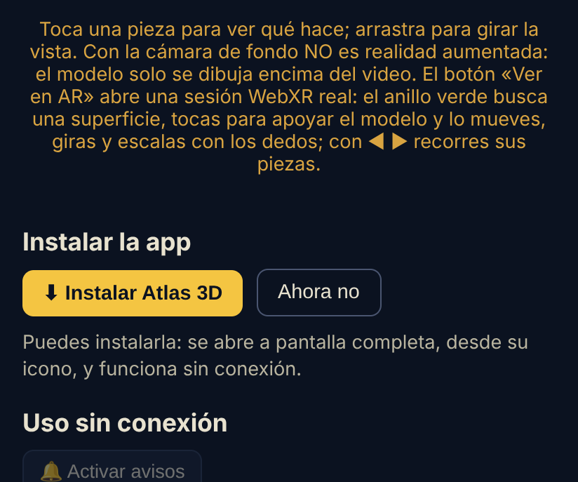
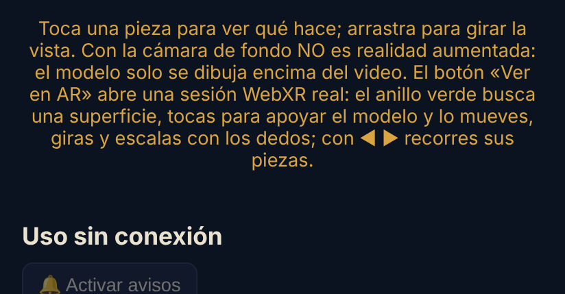
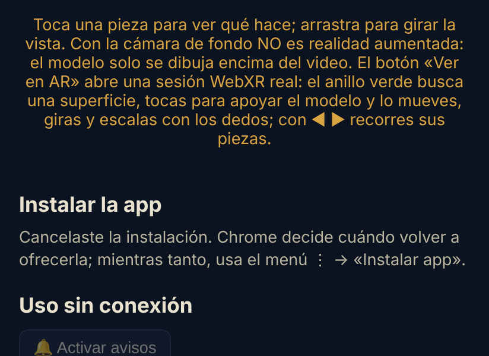
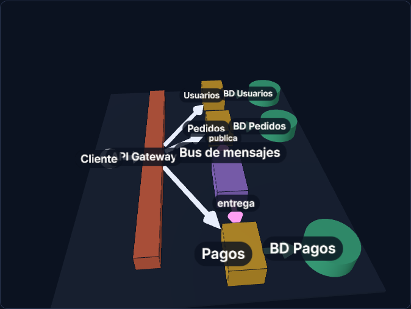
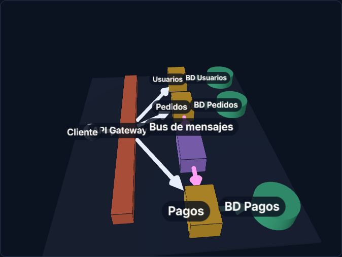
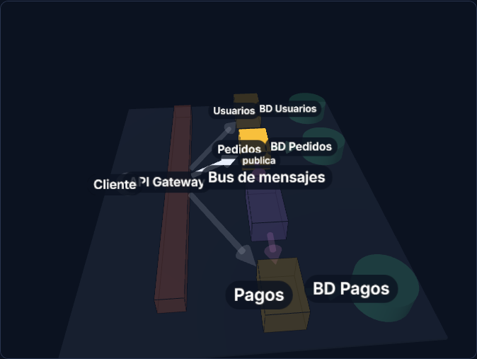

# Sesión 41 · Actividades y entregables

UX/UI de instalación: `beforeinstallprompt`, estados de instalación y aviso de conexión.
Autor: Anthony Alejandro Gonzalez Sanchez · Electiva III – PWA · UPTC

Base de trabajo: checkpoint `pwa-ar-objetos3d-sesion41.zip`. Las tres primeras actividades se aplicaron una
detrás de otra (los diffs están en ese orden). Scripts en `Proyectos/pruebas-actividades/`.

`test_s41.js` no viene en el zip. Se reconstruyó como `t41.js` a partir de la descripción y la salida de la guía:
escenarios A a G con el mismo evento simulado. Contra el checkpoint original pasa completo
(`salidas/41-t41-s41-original.txt`).

---

## Actividad 1 · No insistas: recordar que dijeron «ahora no» (en parejas)

**Código** (`codigo/41-1-ahora-no.diff`, sin tocar `instalar.ts`):

- `index.html`: botón «Ahora no» al lado de «Instalar», con estilo secundario para que no compita con el principal.
- `main.ts`: al pulsarlo se guarda en `localStorage` (`atlas3d-instalar-pospuesta`) el instante del clic.
  `pintarInstalacion()` consulta `pospuestaHasta()`: si no han pasado siete días y el estado es «instalable», la
  sección entera se oculta. Las lecturas y escrituras de `localStorage` van en `try/catch`.

**Decisiones:**

- **Pasados los siete días**, la clave se borra al leerla y la oferta vuelve, siempre que Chrome siga mandando el
  evento. Si el usuario vuelve a decir «Ahora no», empiezan otros siete días.
- **«Ahora no» también oculta el texto explicativo.** Un párrafo que invita a instalar sin botón al lado sigue
  insistiendo, así que desaparece la sección completa. Los estados que solo informan («instalada», «recién
  instalada», iPhone) se siguen mostrando, porque no piden nada.
- Si el usuario pulsa «Instalar» y cancela el diálogo, «Ahora no» desaparece: ya no hay evento que posponer, y el
  texto de «Cancelaste…» sigue siendo el de `instalar.ts`.

**Prueba** (`salidas/41-1y2-pruebas.txt`, script `a41_12.js`): N1 se ven los dos botones; N2 al pulsar «Ahora no»
la sección desaparece y la clave queda guardada; N3 al recargar con un evento nuevo no vuelve; N4 con la clave de
hace ocho días la oferta vuelve y la clave se borra; N5 al cancelar el diálogo no hay ni «Instalar» ni «Ahora no».
Todo en orden. La prueba completa de la sesión (`t41.js`) sigue pasando con el cambio
(`salidas/41-t41-a41-final.txt`).

| 1. Instalable | 2. Pospuesta | 3. Pasados 7 días | 4. Cancelada |
|---|---|---|---|
|  |  |  |  |

**¿Por qué un recordatorio permanente sería peor que no tener botón?** Sin botón, quien quiere instalar todavía
tiene el menú del navegador, y quien no quiere no pierde nada. Un recordatorio que vuelve en cada visita cobra
atención cada vez a alguien que ya respondió. Enseña a ignorar la zona entera (también los mensajes útiles) y hace
sentir que la app no escucha. Respetar un «no» por un tiempo razonable es parte de la experiencia de instalación.

---

## Actividad 2 · Una conexión que se comprueba de verdad (individual)

**La función** (`codigo/41-2-comprobar-red.diff`, en `conexion.ts`):

```ts
export type ResultadoRed = "llega" | "no llega" | "no hay red";

export async function comprobarRed(limiteMs = 4000): Promise<ResultadoRed> {
  if (!navigator.onLine) return "no hay red";            // «false» sí es fiable
  const url = `${import.meta.env.BASE_URL}modelos/mvc.json?comprobar=${Date.now()}`;
  try {
    await fetch(url, { method: "HEAD", cache: "no-store", signal: AbortSignal.timeout(limiteMs) });
    return "llega";                                       // cualquier respuesta, aunque sea un 404
  } catch {
    return "no llega";                                    // error de red o límite de tiempo
  }
}
```

En `main.ts`, cada vez que el navegador dice «en línea» (al abrir y en el evento `online`) se llama a
`comprobarRed()`. Si responde «no llega», la banda dice «Hay red, pero el servidor no responde…» y se reintenta
cada 10 s hasta que llegue. Entonces se muestra «Volvió la conexión.». Un número de turno evita que una respuesta
vieja pise a una nueva.

**Por qué el parámetro `?comprobar=`.** La ruta de `/modelos/` del Service Worker busca la petición en la caché
«modelos-3d» con su URL completa. Con el parámetro nunca la encuentra y la pasa a la red. `cache: "no-store"` evita
además la caché HTTP del navegador.

**Prueba con el servidor de pruebas caído** (el mismo truco de la Sesión 40: el servidor corta las conexiones, que
es lo que pasa de verdad, en lugar de `setOffline`). Salida en `salidas/41-1y2-pruebas.txt`:

| Paso | Resultado |
|---|---|
| R1 servidor arriba | sin banda |
| R2 se descargan las fichas | «3 de 3 fichas guardadas» |
| R3 **servidor caído** y el navegador dice «en línea» | banda «Hay red, pero el servidor no responde…» (en 30 ms) |
| R4 control: la misma ficha sin parámetro, con el servidor caído | **respondió 200**, desde la caché del Service Worker |
| R5 sin red (`setOffline`) | banda «Sin conexión…», sin intentar la petición |
| R6 vuelve todo | «Volvió la conexión.» |

**¿Por qué una petición a un archivo precacheado daría siempre «llega»?** Porque el Service Worker intercepta la
petición y responde desde su caché sin salir a la red. La respuesta llega igual con el servidor caído, como
muestra R4 con una ficha ya descargada. Para comprobar la red hay que pedir algo que el Service Worker no pueda
contestar por su cuenta.

El caso «la red responde, pero muy lento» (límite de 4 s) no se probó con el servidor de pruebas.

---

## Actividad 3 · Rótulos que no se pisen (individual)

**Dos remedios:**

1. **Rótulos de enlace solo con una pieza elegida.** Sin selección no se ve ningún rótulo de enlace; al elegir una
   pieza aparecen los de sus enlaces.
2. **Ordenar los rótulos en pantalla.** En cada fotograma se proyectan los rótulos, se detectan los que se
   superponen y se oculta el de menor prioridad (o se reduce según la distancia).

**Se implementó el 1** (`codigo/41-3-rotulos-enlaces.diff`, en `constructor.ts`): `FlechaConstruida` guarda su
rótulo, que nace oculto, y `resaltar(id)` lo muestra solo si `id` es una de sus dos piezas. Es una línea de lógica,
no gasta tiempo por fotograma y elimina de raíz el choque más visible («publica» con «Bus de mensajes»).

Mismo ángulo en los tres casos (Microservicios, arrastre de 120 px a la izquierda; script `a41_3.js`):

| Antes | Después | Después, con «Pedidos» elegido |
|---|---|---|
|  |  |  |

**Qué mejoró:** desaparecen «publica» y «entrega», que se encimaban con «Pedidos», «Bus de mensajes» y «Pagos».

**Qué costó:** el significado de las flechas ya no se lee de un vistazo. En Capas, «solicita» y «responde» (las dos
flechas paralelas) solo aparecen al elegir una capa, y la leyenda no explica los colores de los enlaces. Además,
este remedio no arregla los choques entre nombres de piezas: «Cliente» y «API Gateway» se siguen pisando en ese
ángulo. Para eso haría falta el remedio 2.

---

## Actividad 4 · Una prueba que falle antes de pasar (individual)

Se quitó `evento = null;` de `pedirInstalacion()` (`codigo/41-4-quitar-evento-null.diff`), se recompiló y se corrió
`t41.js` (`salidas/41-4-t41-sin-evento-null.txt`):

| Antes (original) | Después (sin la línea) |
|---|---|
| C1: `prompt()` 1 vez, botón visible: **false** | C1: `prompt()` 1 vez, botón visible: **true** ✗ |
| D1: tras cancelar, botón oculto y texto «Cancelaste…» | D1: botón visible y texto «Puedes instalarla…» ✗✗ |
| RESULTADO: todo en orden | RESULTADO: hay 4 fallos |

La prueba no siguió en verde: C1 y D1 ya detectan que el botón sobrevive al uso del evento. Aun así se añadió el
escenario **H**, que prueba directamente el doble uso: cancelar el diálogo y volver a pulsar «Instalar» sin que
Chrome haya mandado un evento nuevo. El evento simulado ahora lanza `InvalidStateError` si se llama dos veces a
`prompt()`, igual que Chrome. Sin la línea, H1 da «prompt() llamado 2 veces» y la página registra el
`InvalidStateError`. Con la línea, 1 vez.

Una salvedad: C1 detecta el error porque la reconstrucción mira el botón 300 ms después del clic, cuando la
promesa de `userChoice` ya se resolvió. Una prueba que mirara inmediatamente podría quedar en verde. H no depende
de ese tiempo.
